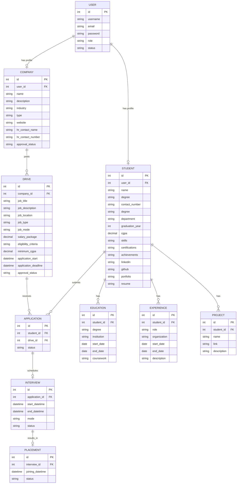

# 🎓 PlacementConnect

## ✨ Placement Portal

A full-stack web application that streamlines the campus placement process for institution, organizations, and candidates. It connects drive creation to application tracking, interview scheduling, and placement offers - all in one unified platform.


---

## 📋 Table of Contents

- [🎓 PlacementConnect](#-placementconnect)
  - [✨ Placement Portal](#-placement-portal)
  - [📋 Table of Contents](#-table-of-contents)
  - [📌 Application Brief](#-application-brief)
  - [🛠️ Tech Stack](#️-tech-stack)
  - [🎯 Features](#-features)
  - [📁 Project Structure](#-project-structure)
  - [🗂️ ER Diagram](#️-er-diagram)
  - [⚙️ Installation and Setup](#️-installation-and-setup)
    - [✅ Prerequisites](#-prerequisites)
    - [➡️ Steps](#️-steps)
    - [🔑 Default Login Credentials](#-default-login-credentials)
  - [📄 License](#-license)

---

## 📌 Application Brief

PlacementConnect is a role-based placement management system designed to manage the end-to-end campus recruitment process. It supports three roles:

- **Admin** — Approves/rejects companies and drives, manages student and company accounts (enable, disable, blacklist, whitelist, delete), and views placement-wide analytics.
- **Company** — Registers, gets approved by the admin, creates and manages recruitment drives, reviews applications, and updates candidate status through interviews and offers.
- **Student** — Builds a profile (education, experience, projects, resume), browses companies and drives, applies or withdraws from drives, and tracks application progress.

The backend is a Flask REST API backed by SQLite, with Celery + Redis handling asynchronous and scheduled jobs (notifications, reminders, reports, exports), and Mailpit used as a local SMTP server for email testing. The frontend is a Vue 3 single-page application (SPA) styled with Bootstrap. All timestamps are stored and displayed in **IST (UTC+5:30)**.

## 🛠️ Tech Stack

**Backend**
- Python, Flask, Flask-RESTX (REST API + Swagger docs)
- Flask-SQLAlchemy (ORM) with SQLite DB (`placement_portal.db`)
- Flask-Mail + Mailpit (local SMTP email testing server)
- Celery Worker (async tasks) + Celery Beat (scheduled tasks)
- Redis (broker/cache)
- openpyxl (XLSX export), xhtml2pdf (PDF report)

**Frontend**
- Vue 3 (Composition API, `<script setup>`)
- Vite (dev server/build tool)
- Vue Router (Route navigation and protection)
- Pinia (state management)
- Axios (HTTP client)
- Bootstrap 5 + Bootstrap Icons

## 🎯 Features

- **Authentication & Authorization** — Registration, login/logout, session-based auth with role-aware routing and automatic session-expiry handling.
- **Company Onboarding** — Company self-registration with admin approval workflow (approve/reject/reapprove).
- **Drive Management** — Companies create, update, and delete recruitment drives; admin approves/rejects drives before they go live to students.
- **Application Workflow** — Students apply to or withdraw from eligible drives; companies review and update application status; admin can inspect any application in detail.
- **Interview & Placement Tracking** — Application → Interview → Placement lifecycle with status progression (Applied/Shortlisted/Rejected, Scheduled/Selected/Not Selected, Offered/Accepted/Declined).
- **Student Profiles** — Rich profiles with education history, work experience, projects, skills, certifications, achievements, and resume/portfolio links.
- **Admin Console** — Dashboard analytics, company/student listing and moderation (enable, disable, blacklist, whitelist, delete).
- **Notifications & Inbox** — Per-role inbox for system-generated notifications, with file attachments.
- **Async Processing (Celery + Redis)** — Background jobs for reminders, scheduled report generation and triggered data export.
- **Email Delivery (Mailpit)** — Transactional and scheduled emails routed through a local SMTP server for safe testing.
- **Caching** — Redis-backed caching layer for dashboard analytics.

## 📁 Project Structure

```
placement_portal/
├── backend/
│   ├── app/
│   │   ├── database/
│   │   │   ├── models.py                # SQLAlchemy models
│   │   │   └── seed.py                  # Seed data
│   │   ├── integrations/
│   │   │   └── processing/
│   │   │       ├── cache/               # Redis config + caching (dashboard)
│   │   │       ├── mail/                # Mailpit config + email templates (notification, reminder, report, export)
│   │   │       └── task/                # Celery config + task functions (notification, reminder, report, export)
│   │   ├── storage/
│   │   │   ├── archived/notifications/  # Archived notification records
│   │   │   └── generated/               # Generated reports, exports
│   │   ├── resources/                   # Flask-RESTX API endpoints (auth, admin, company, student)
│   │   ├── schemas/                     # Request/response marshalling schemas
│   │   ├── services/                    # Business logic layer
│   │   ├── utils/                       # Decorators, error handlers, helpers, validators
│   │   └── main.py                      # App factory (create_app, init_db)
│   ├── instance/                        # SQLite database (created at runtime)
│   ├── init.py                          # Entry point — creates app, initializes DB
│   ├── pyproject.toml
│   └── uv.lock
├── docs/
│   ├── Database_Schema.png
│   └── models.dbml
├── frontend/
│   ├── src/
│   │   ├── assets/                      # Icons, global styles
│   │   ├── components/                  # AppHeader, AppFooter, AppNavbar, AppFlash, AppToast
│   │   │   ├── cards/                   # CompanyCard, StudentCard, DriveCard, ApplicationCard
│   │   │   └── sections/                # CompanySection, StudentSection, DriveSection, ApplicationSection
│   │   ├── router/index.js              # Vue Router configuration
│   │   ├── services/                    # Axios API service modules (auth, admin, company, student)
│   │   ├── stores/                      # Pinia stores (auth, flash, toast)
│   │   ├── views/
│   │   │   ├── admin/                   # Admin dashboard, companies, students, drives, applications, inbox, profile
│   │   │   ├── auth/                    # Login, Register
│   │   │   ├── company/                 # Company dashboard, drives, applications, inbox, profile
│   │   │   └── student/                 # Student dashboard, companies, drives, applications, inbox, profile
│   │   ├── App.Vue                      # Root Vue component
│   │   └── main.js                      # Creates the Vue application instance
│   ├── index.html                       # Loads the main script bundle
│   ├── package-lock.json
│   ├── package.json
│   └── vite.config.js
└── README.md

```

## 🗂️ ER Diagram



> A rendered version of the schema is also available at `docs/Database_Schema.png`.

## ⚙️ Installation and Setup

### ✅ Prerequisites

- **Python** and **uv**
- **Node.js** and **npm**
- **Redis** (via **WSL** on Windows, or natively on Linux/macOS)
- **Mailpit** for local email testing
- **PowerShell** (or any terminal) capable of running multiple concurrent processes

### ➡️ Steps

The application requires **7 concurrent processes**: Flask, Vue, Redis (2), Celery (2), and Mailpit. Start them in the order below (F → V → M → R → C).

1. **Create a project folder and navigate into it** 
    ```
    mkdir placement_portal
    cd placement_portal
    ```

2. **Clone/open/copy the project** — the expected directory layout is:

   ```
   placement_portal/
   ├── backend/
   ├── frontend/
   ```

    **(Optional) Reset the database and clear cache files to re-initialize app**  
    This will delete the existing SQLite database and remove _pycache_ folders  

    On Windows PowerShell with Git Bash installed:  
    ```bash -c 'find . -type d -name "__pycache__" -exec rm -r {} +; rm -f ./backend/instance/placement_portal.db'```  

    On macOS/Linux:  
    ```find . -type d -name "__pycache__" -exec rm -r {} +; rm -f ./backend/instance/placement_portal.db'```

3. **Backend (Flask)**

   ```powershell
   cd path\to\placement_portal
   cd backend
   uv sync
   uv run init.py
   ```

   The Flask API starts at `http://127.0.0.1:5000`.

4. **Frontend (Vue)**

   ```powershell
   cd path\to\placement_portal
   cd frontend
   npm install
   npm run dev
   ```

   The Vue UI is served at `http://127.0.0.1:8000`.

5. **Redis** (Server + CLI, run in separate terminals)

   ```powershell
   wsl redis-server
   wsl redis-cli
   ```

6. **Celery** (Worker + Beat, run in separate terminals)

   ```powershell
   cd path\to\placement_portal\backend
   uv run celery -A app.integrations.processing.task.celery:celery worker -P solo -E --loglevel=info
   uv run celery -A app.integrations.processing.task.celery:celery beat --loglevel=info
   ```

7. **Mailpit**

   ```powershell
   mailpit
   ```

   The Mailpit web UI is available at `http://127.0.0.1:8025` by default.

> The SQLite database (`placement_portal.db`) and default admin account are created automatically on first run of the backend — no manual migration or seeding step is required.

### 🔑 Default Login Credentials

| Role    | Username        | Email                                | Password          |
|---------|-----------------|--------------------------------------|-------------------|
| Admin   | `administrator` | `administrator@placementconnect.com` | `administrator123`

> Seed data also creates sample **Company** and **Student** accounts (see `backend/app/database/seed.py` for the full list.)

---

## 📄 License

This project is licensed under the [GNU General Public License v3.0](LICENSE).
